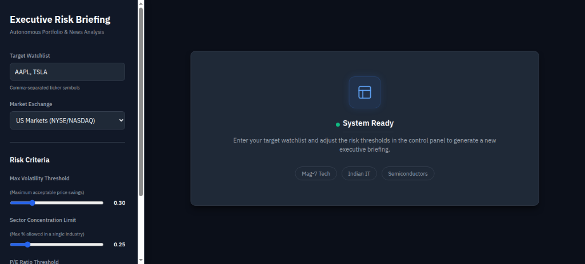
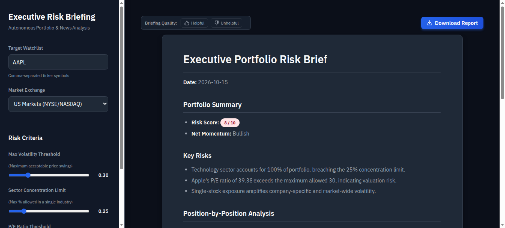
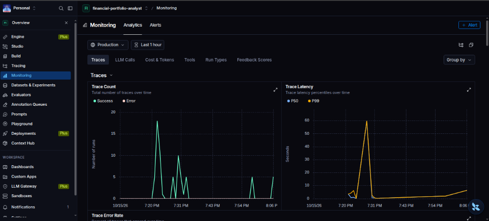
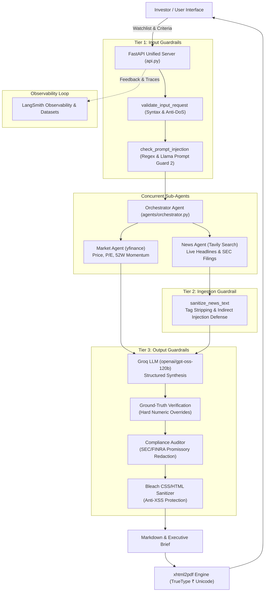

# 📈 Autonomous Financial Portfolio & News Analyst

[](https://www.python.org/)
[](https://fastapi.tiangolo.com/)
[](https://groq.com/)
[](https://www.langchain.com/)
[](https://smith.langchain.com/)
[](https://opensource.org/licenses/MIT)

An institutional-grade, multi-agent AI system designed to autonomously monitor, evaluate, and brief investors on portfolio health, valuation risks, and real-time market sentiment across both **US Markets (NYSE/NASDAQ)** and the **Indian Market (NSE)**.

The system harmonizes real-time quantitative fundamentals with qualitative news signals, enforces **3-Tier security and regulatory compliance guardrails**, and compiles executive briefings with one-click **Unicode-ready PDF exports**.

---

## 📸 Demo & Screenshots

### 1. Interactive Risk Control Panel
*Customize target watchlists, select market exchanges (US or NSE), configure valuation limits (P/E ratio), volatility ceilings, and sector concentration thresholds.*



---

### 2. Autonomous Executive Brief & PDF Export
*Synthesizes risk scores (1-10), position-by-position breakdowns, momentum reconciliations, and red flags. Includes user satisfaction feedback widgets and one-click PDF generation.*



---

### 3. Production Monitoring & LangSmith Observability
*Live tracing of every sub-agent tool call, latency percentiles (P50/P99), token usage, user feedback scores, and automated benchmark evaluations.*



---

## 🏛️ System Architecture



---

## ✨ Key Features

- **Multi-Market Support:** First-class support for US stocks (`AAPL`, `NVDA`, `TSLA`) and Indian equities (`INFY.NS`, `TCS.NS`, `RELIANCE.NS`) with automatic currency glyph rendering (`$` and `₹`).
- **Concurrent Sub-Agents:** Parallel execution of market data retrieval (`yfinance`) and web news synthesis (`Tavily`), reducing briefing latency by over 40%.
- **3-Tier Defense-in-Depth Guardrails:**
  - **Tier 1 (Input):** Regex ticker format checks, anti-DoS limits ($\le 20$ tickers), and Meta's Llama Prompt Guard 2 (86M).
  - **Tier 2 (Ingestion):** Neutralization of indirect prompt injections and instruction hijacking embedded in scraped web articles.
  - **Tier 3 (Output):** Bleach HTML sanitization against stored XSS and automated regex scrubbing to enforce SEC/FINRA non-promissory advice standards.
- **Deterministic Ground-Truth Overrides:** Eliminates hallucinated stock prices, P/E ratios, and 52-week momentum by overriding LLM outputs with verified market feed numbers.
- **Executive PDF Briefing:** Landscape A4 PDF generator embedding TrueType fonts (`DejaVuSans`) for universal Unicode and Rupee sign (`₹`) rendering.
- **Production Observability & Feedback:** Full `@traceable` integration with LangSmith for run tracing, latency monitoring, and real-time user satisfaction telemetry.

---

## 🚀 Quick Start Guide

### 1. Prerequisites
- **Python 3.10+**
- **Groq API Key:** [Get your key from Groq Console](https://console.groq.com/)
- **Tavily API Key:** [Get your key from Tavily AI](https://tavily.com/)
- **LangSmith API Key (Optional):** [Get your key from LangSmith](https://smith.langchain.com/)

---

### 2. Installation

1. **Clone the repository:**
   ```bash
   git clone https://github.com/<your-username>/autonomous-financial-analyst.git
   cd autonomous-financial-analyst
   ```

2. **Create and activate a virtual environment:**
   ```bash
   python3 -m venv .venv
   source .venv/bin/activate  # On Windows: .venv\Scripts\activate
   ```

3. **Install dependencies:**
   ```bash
   pip install -r requirements.txt
   ```

---

### 3. Environment Configuration

Copy the example environment file:
```bash
cp .env.example .env
```

Edit `.env` and insert your credentials:
```env
# LLM & Market Analysis Keys
GROQ_API_KEY="gsk_..."
TAVILY_API_KEY="tvly-..."
SEC_USER_AGENT="YourName yourname@example.com"

# LangSmith Observability Configuration (Optional)
LANGCHAIN_TRACING_V2=true
LANGCHAIN_ENDPOINT="https://api.smith.langchain.com"
LANGCHAIN_API_KEY="lsv2_pt_..."
LANGCHAIN_PROJECT="financial-portfolio-analyst"
```

---

### 4. Running the Web Application

Start the unified server (FastAPI serves both the frontend UI and backend API):
```bash
uvicorn api:app --host 127.0.0.1 --port 8000 --reload
```

Open your browser and navigate to:
👉 **[http://127.0.0.1:8000](http://127.0.0.1:8000)**

---

## ⚖️ Disclaimer

*This application is for informational and educational purposes only. It does not constitute financial, investment, or legal advice. All analyses are generated autonomously by AI models and external data providers. Verify all data and consult with a licensed financial advisor before making any investment decisions.*
